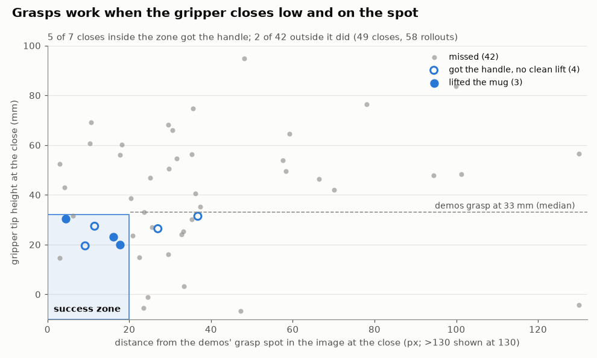

# Afford2Act on a low-cost SO101 arm: pick up a mug by its handle

A reproduction of [Afford2Act](https://arxiv.org/abs/2510.01433) ("How Far Can Sparse Keypoints Go") on the
LeRobot SO101 arm. The policy sees only **19 points in the camera image**: 15 on the mug's handle and 4 on the gripper.
It outputs the next second of arm-joint changes and the gripper command.

**Result:** with the setup in this repo, the SO101 lifted the mug by its handle in 3 of 13 rollouts (2 held, 1 dropped
it), after 0 lifts in the 45 rollouts of the earlier setups. Trained on 40 teleoperated demos.

- Watch: [`docs/best3_side_by_side.mp4`](docs/best3_side_by_side.mp4): the 3 lifts side by side (40 s), and
  [`docs/best_runs.mp4`](docs/best_runs.mp4): all 7 rollouts that got the handle, real speed, with live graphs.
- How the 4 gripper points are computed from the joints: [`docs/ep_001_gripper_fk.mp4`](docs/ep_001_gripper_fk.mp4).
- What differs from the paper and why: [`NOTES_vs_paper.md`](NOTES_vs_paper.md).



## How it works

```
 first camera frame ──► OOAL "hold" + DINO match to a reference frame ──► 15 handle points
 every step:
   camera ──► CoTracker (online) ──► 15 handle points
   measured joints ──► forward kinematics ──► camera calibration ──► 4 gripper points
   19 points (x, y) from now, 0.5 s and 1.0 s ago ──► policy (TinyTransformer + gate)
        ──► next 10 changes of the 5 arm joints + 10 x P(gripper closed)
        ──► average of the last 10 plans ──► joint target = previous target + change
        ──► feedback loop: wait until the arm is within 1 deg ──► SO101
   gripper: opened at the start; closes when the averaged P(closed) > 0.6, stays closed >= 2 s
```

## Repository layout

| Path | What |
|---|---|
| `1_record.py`, `record_view.py` | record demos with the SO101 leader / follower (teleop), front RealSense, wrist camera, ArUco marker |
| `2_process.py` | joints in the current calibration, gripper pose (FK) and gripper-closed label per frame |
| `3_track.py` | 15 handle points: OOAL + DINO on the first frame, CoTracker through the demo |
| `4_fit_camera.py` | fits the camera-to-robot calibration from the demos (marker corners + joints) |
| `5_fk_points.py`, `fk_points.py` | the 4 gripper points from the joints; the 19-point policy input per frame |
| `6_make_reference.py` | the reference frame a robot run matches its first frame against |
| `7_train.py` | trains the policy (~16 min on one GPU) |
| `8_run_robot.py` | runs it on the SO101: one rollout or a session; live view, graphs, video, logs |
| `common.py`, `liveview.py` | paths, calibration helpers, browser live view |
| `calib/camera_robot.json` | the fitted camera calibration of our setup |
| `references/mug_a2a/` | the reference frame (demo ep_009) |
| `data/mug_a2a/` | the 40 processed demos: joints, gripper pose, 19 points per frame (no images) |
| `models/mug40fk_gl_h/` | the trained model that lifted the mug |
| `docs/` | videos, the chart above, `results/` (all 58 analysed rollouts) |

## Setup

1. **Python environment** (tested: Python 3.12, Ubuntu, NVIDIA GPU):
   ```
   conda create -n so101a2a python=3.12 && conda activate so101a2a
   pip install -r requirements.txt
   ```
2. **Outside code** (not copied here; each has its own licence). Set the paths, or place them at the defaults:

   | What | Default location | Variable |
   |---|---|---|
   | Afford2Act authors' code (the folder with `OOAL/` and `d3_utils/`) | `../afford2act` | `A2A_REPO` |
   | OOAL checkpoint `seen_best` (download link in OOAL's README) | `checkpoints/ooal/seen_best` | `OOAL_CKPT` |
   | SO101 robot model: `git clone https://github.com/TheRobotStudio/SO-ARM100 third_party/SO-ARM100` | `third_party/SO-ARM100/Simulation/SO101/so101_new_calib.urdf` | `SO101_URDF` |

   CoTracker3 is downloaded automatically through `torch.hub` at first use.
3. **Hardware we used:**
   - SO101 follower and leader (Feetech), with the leader facing the follower (mirrored teleop);
   - an Intel RealSense D435i on the side, 1280x720 at 15 fps;
   - a USB wrist camera (recorded only);
   - an ArUco marker (DICT_4X4_50, id 0) on the moving jaw, needed only for recording and the camera fit.

   Port names, camera serial, mirror centre and home pose are constants at the top of `1_record.py`.
4. **Arm calibration files.** LeRobot keeps them in `~/.cache/huggingface/lerobot/calibration/`.
   - The demos were recorded with `my_follower_arm_v4` / `my_leader_arm_v4` and processed into `my_follower_arm_v5`.
   - The scripts convert between saved calibrations exactly and never write calibration into the motors.
   - On a different arm, record your own demos and use your own calibration ids (`--follower_id`).
5. **GPU:** scripts use CUDA device 1 by default (`--gpu`), because GPU 0 of our lab PC is shared. Use `--gpu 0` on a
   single-GPU machine.

## Run the included model on the robot

Place the mug as in the demos, in the same light: handle pointing left, its loop visible from the camera, inside the
magenta box. Then:

```
python 8_run_robot.py                       # dry run: camera + policy, motors only read, nothing moves
python 8_run_robot.py --execute --session   # many rollouts, controlled from the terminal
```

Live view: http://localhost:8770 (camera with the points, plus graphs: tip target vs real, gripper, feedback loop).

| Step | What happens | Keys (type, then Enter) |
|---|---|---|
| READY | the arm holds the start pose; place the mug | Enter = check   q = quit |
| CHECK | the first frame with its handle points; aim for about 15 (training always had 15) | Enter = run   c = check again   q = quit |
| RUN | the rollout (at most `--seconds`, default 60) | Enter = stop early   Ctrl+C = end the session |
| REVIEW | after the arm has returned | Enter = keep   d = discard (moved to `_discarded/`)   r = replay |

- **Where results go:** each rollout is saved in `runs/<model>_session_<time>/roll_NNN/`: `video.mp4`, `log.csv`
  (commands, measured joints, feedback loop), `inputs.csv` (the 19 points of every step) and `first_frame.png`.
  `session.csv` lists all rollouts.
- **Ending a session:** use `q`. Ctrl+C can cut off the last video's conversion.
- **Before the arm goes limp:** at the end the follower goes limp, so support it.

## Rebuild everything from your own demos

```
python 1_record.py --task mug_a2a -n 40                            # demos -> recordings/mug_a2a/
python 2_process.py --src recordings/mug_a2a --out data/mug_a2a    # joints, FK pose, gripper label
python 3_track.py --data data/mug_a2a --ref ep_009                 # 15 handle points per demo
python 4_fit_camera.py --data data/mug_a2a                         # camera calibration (refit if the camera moves)
python 5_fk_points.py --data data/mug_a2a                          # 4 gripper points + policy input
python 6_make_reference.py --data data/mug_a2a --ref ep_009        # reference frame for robot runs
python 7_train.py --data data/mug_a2a --name my_model              # train (~16 min)
python 8_run_robot.py --policy models/my_model --execute --session
```

- **Checked against our files:**
  - on raw demos ep_001 and ep_009, steps 2, 3, 5 and 6 give the included files byte for byte;
  - step 4 on the included data gives `calib/camera_robot.json` exactly;
  - step 7 matches the included model's training log exactly over the 50 epochs checked.
- **What the demos need:** start with the gripper closed at the home pose, open it, reach, grasp the handle, lift
  (anything after the lift is not used).
- **Marker:** keep the marker visible in many frames; the camera fit needs it.

## Results

All 58 rollouts of 2026-11-16/17, outcomes judged from the videos (`docs/results/rollouts.csv`):

| Setup | Rollouts | Lifted (held / dropped) | Arm vs command (median) |
|---|---|---|---|
| frame number, no feedback loop | 25 | 0 | 7.6 mm |
| frame number + feedback loop | 3 | 0 | 1.6 mm |
| no frame number + history | 9 | 0 | 7.8 mm |
| no frame number + history + feedback loop | 7 | 0 | 1.5 mm |
| no frame number + history + gripper opened at start + smoothing, no feedback loop | 1 | 0 | 9.6 mm |
| **this repo: + gripper opened at start + smoothing** | **13** | **2 / 1** | **1.8 mm** |

The remaining failures are mostly closes that are too high or a little off the handle: the 2D points carry little
height information from one camera. See `NOTES_vs_paper.md`.

## Credits and licences

- **Afford2Act paper:** method, policy and data pipeline. The authors' code is MIT (Anukriti Singh), used here as
  an outside dependency.
- **OOAL** (MIT, Gen Li): affordance grounding.
- **DINO** (via the authors' `d3_utils`): correspondences.
- **[CoTracker](https://github.com/facebookresearch/co-tracker)** (CC BY-NC 4.0, non-commercial): point tracking.
- **[LeRobot](https://github.com/huggingface/lerobot):** SO101 drivers and kinematics.
- **[SO-ARM100](https://github.com/TheRobotStudio/SO-ARM100):** robot model.

This repository has no licence file yet.
